# 基于Jev的文献分类系统


## 一、项目背景

我最近想着把Zotero里的文献整理一下，发现之前的分类体系有些乱，有点无从下手，一直在纠结是把文献放到哪一个类别目录下，或者是应该新建一个类别目录。整着整着就开摆了。。。

大家收集整理文献的时候可能也会遇到诸如此类的问题，例如：

- 刚开始读文献时建立的类别，后来越来越宽泛。研究方向有变化，新的主题不断加进来，旧目录又没来得及调整。
- 有些论文涉及多个主题，放在哪一类都不太合适。先勉强放进去，过一阵又想不起当时为什么这么分。

最近关注到 Jev，用这个模型来做文献分类似乎非常合适，它能在预先定义的选项里做判断，返回文献属于各类别的概率。我就想着尝试借助它来整理本地文献。

于是国庆期间抽空捣鼓了这个文献分类系统，最近又稍微完善了一下。现在可以这样用：

- 已经有分类思路，自己填写类别名称和边界，保存后交给 Jev 批量分类。
- 分类目的明确，但还没想好具体分成哪几类，可以借助通用大模型生成 3–5 套候选方案，选一套、改好边界，再用 Jev 分类。
- 把结果存至本机 Zotero，在复核后选择一次分类运行的结果，预览条目匹配，确认后写入分类标签或分类目录。

前两种方式都能独立完成，结果可以导出 CSV 或 JSON。不使用 Zotero 也能正常上传、分类和复核。如果要整理的PDF原本保存在 Zotero 附件里，先把本地 PDF 上传到工作台，分类完成后再按需导入。

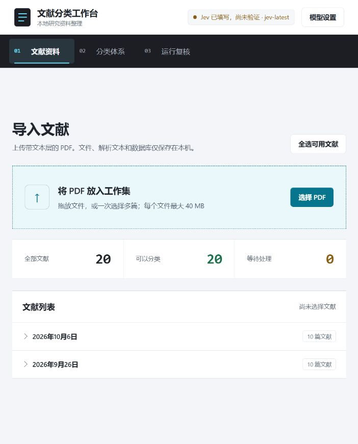

## 二、什么是Jev

Jev 是 TypeSafe AI 推出的首个 System One 模型，主要用来根据输入内容做判断。TypeSafe AI 的创始人 Diogo Almeida 曾在 OpenAI 参与指令遵循和对话模型相关研究。使用 Jev 时，需要给出待判断的内容、问题和允许的答案范围，它会直接返回结构化结果。文献分类就是这类任务：说明每个类别的含义，再判断论文最符合哪一类。相关介绍见 [官方文档](https://docs.typesafe.ai/introduction) 和 [发布文章](https://typesafe.ai/blog/introducing-system-one-models-and-jev)。

用通用大模型分类，通常要让它生成回答，再从回答中提取类别。Jev 省去了自由文本生成这一步，把输出限制在事先定义好的判断结果里，也就减少了生成和解析文本的开销，非常适用于需要反复处理、答案范围又比较明确的任务。


Jev 提供三种输出原语：

- `Choice`：从给定选项中选出最符合的一项，返回所选类别、全部选项的概率和置信度。适合文献分类、工单分流和意图识别。
- `Score`：按照预先定义的有序等级评分，返回分数、各等级概率和置信度。例如，可以用“无关、弱相关、较相关、高度相关”来评估相关性，也可以评估优先级或严重程度。分数根据等级概率计算，可以是小数。
- `Noul`：判断一个说法是否成立，返回“是”的概率，范围为 0–1。例如判断是否涉及某个主题、是否需要人工处理，再由应用按阈值转换成布尔结果。


三种类型的具体定义分别见 [Choice](https://docs.typesafe.ai/primitives/choice)、[Score](https://docs.typesafe.ai/primitives/score) 和 [Noul](https://docs.typesafe.ai/primitives/noul) 文档。

本项目使用的是 `Choice`。每篇文献在一套体系下选一个最匹配的类别，同时保留其他类别的概率。系统还加入了“不属于以上类别”选项，超出分类范围或信息不足的文献可以留作未分类。

对整理文献来说，概率分布比单独一个类别更方便复核，如果两个类别的概率接近，可以先检查论文内容和类别边界；如果概率明显集中在一类，则更容易判断是否接受结果。页面还会显示 `confidence`，它由概率分布计算，与某个类别的概率含义不同，也不能当作分类正确率的保证。具体见 [置信度说明](https://docs.typesafe.ai/confidence)。

所以，这个项目里两个模型有着不同的用途：通用大模型只负责拟定候选分类体系，是否采用、怎样修改由使用者决定；Jev 按保存后的类别边界分类。不符合当前体系的论文可以标记为未分类，模型不会在复核过程中自行增加类别。

## 三、项目能力

### 1. 上传 PDF，检查和修正元数据

支持多文件选择和拖放上传，默认每个文件最大为 40 MB。当用户上传文献之后，系统会按文件内容哈希识别重复文件，并提取标题、摘要、关键词和正文文本，按待处理状态和本地上传日期组织文献列表。

解析可靠的文献可以直接分类。标题只能从文件名推断、可提取文本太少、异常字符较多或解析失败时，需要人工处理。缺少关键词、未识别到摘要会提示，但不会单独阻止分类。当前依赖 PDF 文本层，尚无 OCR；无法提取文本时，可以手工补充元数据。

### 2. 自定义分类体系

用户可以自己填写体系名称、分类目的、类别名称和“定义与边界”，至少建立两个类别。内部类别标识由系统维护，不需要手工填写代码。

同一体系围绕一个明确维度分类，例如研究对象或研究方法。类别边界应说明纳入什么、与相邻类别怎么区分，避免把不同标准混在一起。

### 3. 自动生成候选分类体系

至少选择两篇可用文献，填写分类目的、类别数量和候选方案数量后，通用模型可生成 3–5 套方案，每套包含 2–20 个类别。页面会显示“模型理解的分类维度”，可以先检查它的理解是否存在偏差，再比较各套方案。

所有候选方案都围绕用户指定的维度调整名称、边界和粒度，选中后仍可编辑，保存后才用于分类。生成模型接收的是从所选文献标题和摘要统计得到的精简语料概况，包括文献数量、摘要覆盖情况、语言分布和高频词；不会读取未选文献、完整论文正文或电脑里的其他文件。

### 4. 编辑体系，保留历史版本

修改体系会创建新的当前版本，原版本转入历史区域。已有分类运行继续关联原来的体系版本，可以回看当时的类别定义。

删除体系需要确认，删除范围包括整个版本家族及关联的分类运行和结果。体系有排队或运行中的任务时，不允许删除。

### 5. 批量分类，查看全部类别概率

选好文献和当前体系后，可以启动后台并发分类，页面显示进度、成功数和失败数。有摘要时，Jev 使用标题、摘要和关键词（L1）；没有摘要时，再补充正文开头最多 6,000 个字符（L2）。

每次运行关联具体的体系版本，结果保留模型版本和输入层级，文献记录保留内容哈希。结果按体系版本、运行批次和类别浏览，每个类别内，需要处理和置信度较低的文献排在前面。点击文献可查看全部类别概率、总体置信度和前两类概率差值。

### 6. 人工复核，导出和删除结果

可以确认分类、修正为已有类别、暂不分类或标记为未分类，并填写备注。人工修正后，原始概率仍会保留；未分类结果不会触发新类别创建或自动重新分类。

支持按当前运行导出 CSV 和 JSON，也支持经确认后删除单条结果或整个运行。删除运行会保留分类体系，便于之后重新分类。

### 7. 导入本地 Zotero

从选定的分类运行生成导入预览，匹配明确时复用已有条目，没有合适条目时新建通用“文档”条目并导入 PDF 附件。匹配到多个候选条目时，需要手动选择。

分类标签和分类目录可以分别勾选，也可以同时写入，至少选择一种。系统保留本地关联，便于失败后重试；再次导入只更新当前体系路径下的标签和类别目录，其他用户标签和集合均会保留。所有写入都要先预览、再确认。


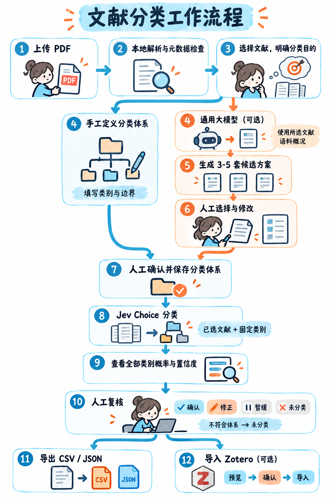


## 四、项目使用

### 使用前准备

需要 Python 3.12。在项目根目录安装依赖并启动，使用已有的 Conda 环境 `paper_manage` 时运行：

```powershell
conda activate paper_manage
python -m pip install -r requirements.txt
python start_server.py
```

如果尚未创建环境，可先运行 `conda create -n paper_manage python=3.12`。启动后打开 <http://127.0.0.1:8000>。前端由 FastAPI 直接提供，不需要安装 Node.js 或单独构建。

然后配置模型：

1. 点击页面右上角“模型设置”。
2. 填写 TypeSafe API Key 和 Jev 模型名称，默认使用 `jev-latest`。密钥可在 [TypeSafe Console](https://console.typesafe.ai/settings/keys) 创建（嫌自己申请麻烦的朋友可以关注并私信我，我直接提供密钥，共5美元额度，先到先得。或者去某鱼直接购买）。
3. 需要自动生成候选体系时，需要额外填写通用模型的 API Key、API 地址和模型名称。默认连接硅基流动，地址为 `https://api.siliconflow.cn/v1`；也支持采用 Bearer 认证、兼容 OpenAI Chat Completions 且支持 JSON 输出的服务。
4. 点击“保存配置”。系统通过 TypeSafe 的可用模型接口检查 Jev 密钥和所选模型，不会在此时发起分类推理。
5. 查看是否显示“连接正常”。如果提示认证失败、模型不可用或连接异常，检查对应配置和网络。

未配置通用模型 API Key 时，“自动生成分类体系”功能不可用，手工建分类体系和基于 Jev 的文献分类仍然可用。

模型设置写入本机项目根目录的 `.env`，密钥不会通过 API 回显，也不会存入浏览器存储。再次打开设置时，密钥框保持空白；留空保存表示继续使用已有密钥。服务重启后，Jev 会显示“尚未验证”，再次保存设置可重新验证。

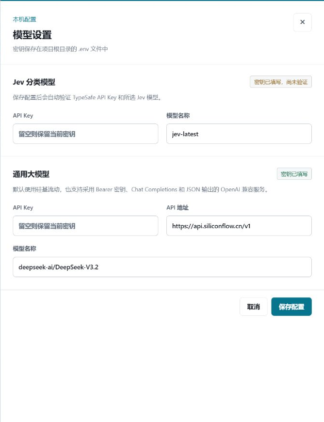

### 1. 上传 PDF，检查和修正元数据

1. 进入“文献资料”页，点击“选择 PDF”，或把多个 PDF 拖到上传区域。
2. 等待解析完成，查看通知中的可分类数量、需处理数量和重复文件提示。
3. 先看“需要处理”分组，点击文献旁的“处理”，核对提取结果和质量提示。
4. 修正标题、摘要和关键词后保存。解析失败的文件建议补充能支持分类的摘要，仅填一个标题往往不够。
5. 已经可分类的文献也可以通过“查看/修正”检查元数据。
6. 勾选这次要整理的文献，或点击“全选可用文献”。后续生成方案和分类都以当前选择为准。

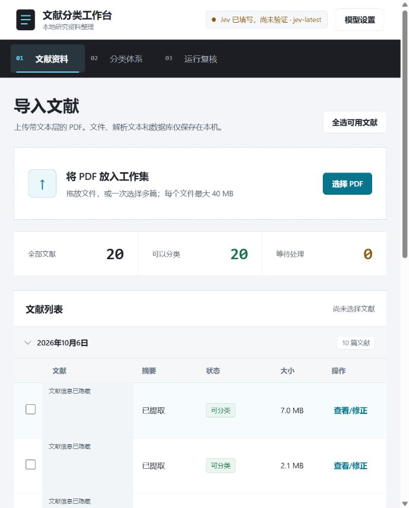


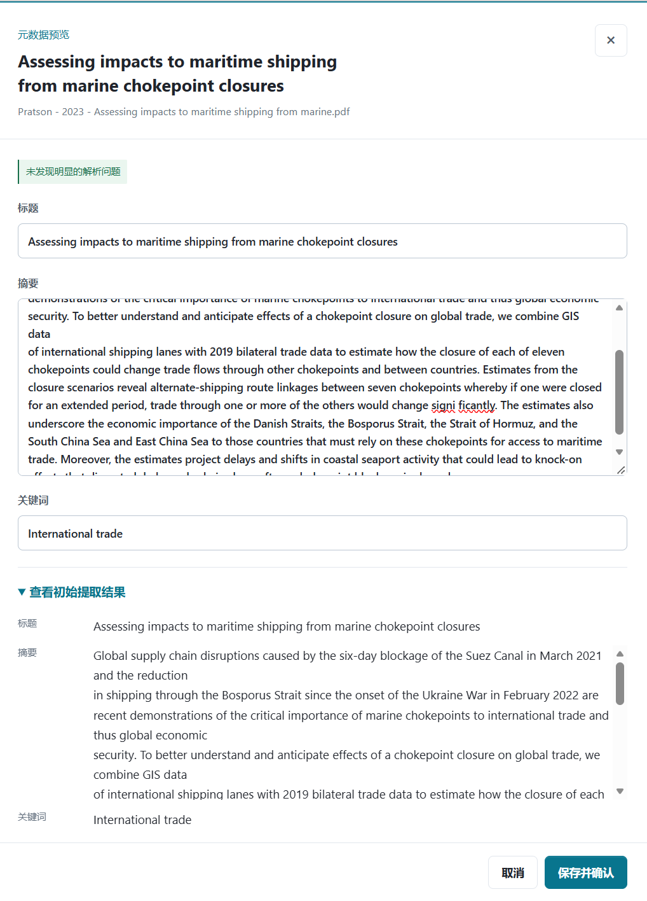

### 2. 自定义分类体系

1. 进入“分类体系”页，选择“自定义分类体系”。
2. 填写“分类体系名称”和“分类目的”，例如“城市研究对象分类”和“按照主要研究对象划分文献”。
3. 填写每个“类别名称”和“定义与边界”，说明纳入内容，以及与相邻类别的区别。
4. 点击“添加类别”补充类别，至少保留两个。
5. 点击“保存分类体系”，再到“运行复核”页开始分类。

边界可以写得具体一些。比如“交通系统”可以定义为：主要研究道路网络、交通流、出行行为及交通设施；仅把交通可达性作为辅助变量的住房研究不归入本类。

如果按研究对象分类，这套体系里的类别就都围绕研究对象建立。想再按研究方法整理，可以另建一套体系。

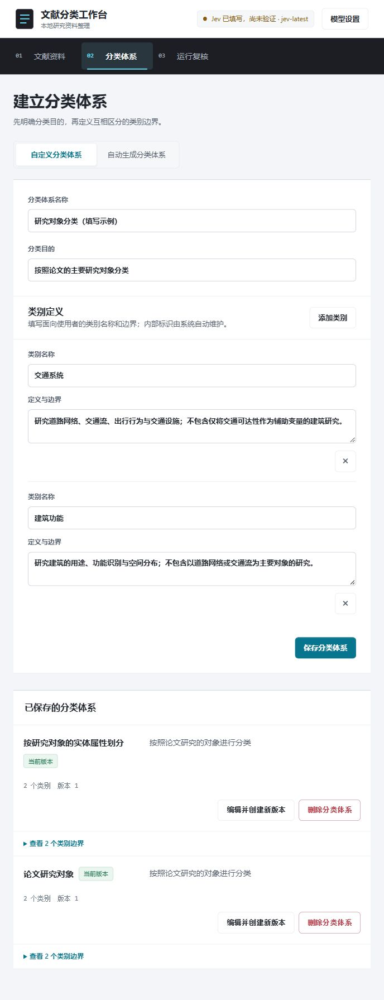

<details>
<summary>自定义分类体系首屏截图</summary>

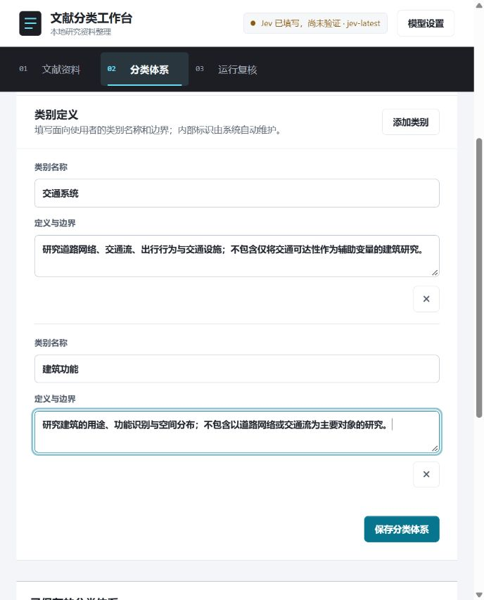

</details>

### 3. 自动生成候选分类体系

1. 在“文献资料”页至少选择两篇可分类文献，并确认已配置通用模型。
2. 进入“分类体系”页，选择“自动生成分类体系”。
3. 填写分类目的，设置类别数量（2–20）和候选方案数量（3、4 或 5 套）。
4. 点击“生成分类方案”，等待结果。
5. 先看“模型理解的分类维度”是否符合预期，再比较各套方案的类别名称、覆盖范围和边界。
6. 点击“选择此方案”，在编辑表单中调整类别。
7. 检查后点击“保存分类体系”。

如果模型理解错了分类维度，改清楚分类目的后重新生成；如果只是类别边界不合适，可以直接修改所选方案。

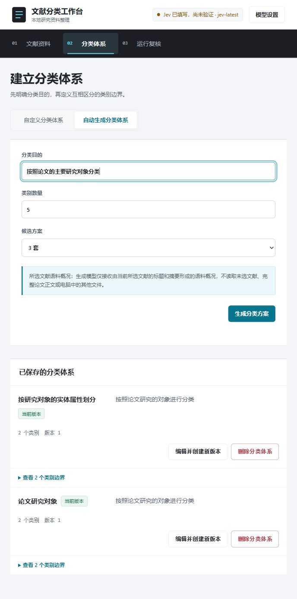


### 4. 编辑体系，保留历史版本

1. 找到已保存的分类体系，展开“查看类别边界”。
2. 点击当前版本的“编辑并创建新版本”。
3. 修改名称、目的或类别边界，点击“保存分类体系”。
4. 查看新版本和历史版本。新分类使用当前版本，旧运行继续保留原版本定义。
5. 要看旧结果，在“运行复核”页选择对应的“分类体系版本”和“运行批次”。

不再需要整套体系时，可以点击“删除分类体系”。确认前看清范围：它会永久删除全部历史版本和关联的分类运行、结果，无法恢复。


### 5. 批量分类，查看全部类别概率

1. 在“文献资料”页勾选要分类的文献。
2. 进入“运行复核”页，选择一套当前分类体系。
3. 核对待分类数量，点击“开始分类”。
4. 查看进度、成功数和失败数，等待任务结束。
5. 在“分类结果”区域选择“分类体系版本”和“运行批次”。
6. 点击类别标签切换结果表，优先处理需要复核和置信度较低的文献。
7. 如果有分类失败的文献，检查失败原因和模型配置，解决后可选择相关文献启动新的运行。

运行期间请保持本地服务运行。当前已有并发处理能力，但服务重启后的任务自动恢复尚未完成。L3 长文本补充也尚未实现。

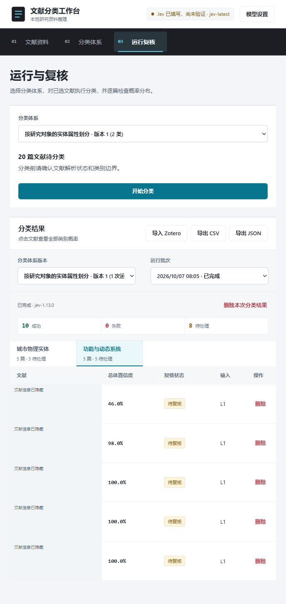

### 6. 人工复核，导出和删除结果

1. 点击结果表里的一篇文献，打开详情。
2. 查看最终类别、总体置信度、前两类差值和全部类别概率，结合文献内容与分类目的判断。
3. 需要记录依据时，先填写“复核备注”。
4. 判断合理就点击“确认分类”；要改为其他已有类别，就在“修正类别”中选择后点击“保存修正”。
5. 暂时无法判断时点击“暂不分类”；不符合当前体系或信息不足时，点击“标记为未分类”。

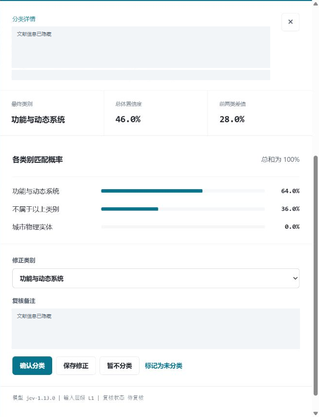

复核后可以导出：

1. 选定分类体系版本和运行批次。
2. 点击“分类结果”标题栏的“导出 CSV”或“导出 JSON”。
3. 保存下载文件。导出范围是当前运行，不会混入其他批次。

CSV 适合放进表格里查看，包含文献名称、类别、置信度、复核状态、模型版本、输入层级和概率。JSON 保留更完整的结果字段，适合后续程序处理。

需要删除时：

1. 删除单条结果，点击该条末尾的“删除”，确认后移除。
2. 删除整批结果，点击“删除本次分类结果”，核对批次后确认。

删除单条结果后，运行总数、成功数和失败数会重新计算；最后一条结果删掉时，空运行也会移除。整批删除会保留分类体系。排队或运行中的任务不允许删除结果。

### 7. 导入本地 Zotero

需要运行支持 Local API 写入的 Zotero 10 或更高版本。

1. 启动 Zotero，在“设置 → 高级”中启用“允许此计算机上的其他应用与 Zotero 通信”。
2. 在工作台里选好体系版本和运行批次，完成必要的复核，点击“分类结果”标题栏的“导入 Zotero”。
3. 等待连接检测和导入预览，检查每篇文献准备复用的条目。
4. 多个候选条目都可能匹配时，手动选对；没有合适条目时，选择新建。
5. 勾选“导出标签”“导出目录”或两者，至少保留一项。
6. 点击“确认导入”，核对新建、复用数量和写入方式，再确认执行。
7. Zotero 弹出授权窗口时按需授权。批量导入建议选择“始终允许”，避免创建条目、附件等连续写入反复弹窗。
8. 查看逐篇导入结果。失败项解决问题后可以重新预览、重试，已经建立的本地关联可用于复用条目。

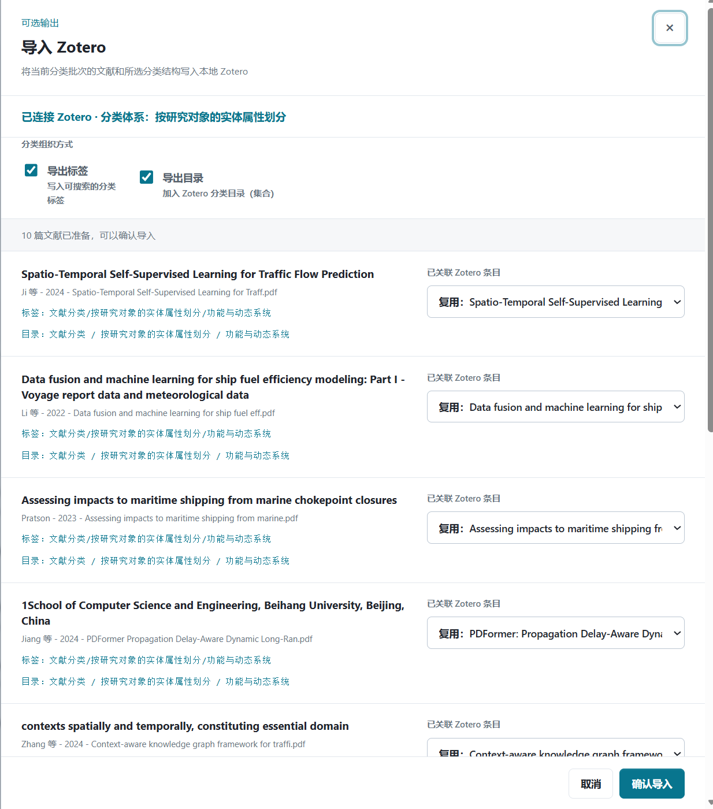

*图中展示 Zotero 未连接时的导入窗口和输出选项。*

分类标签采用以下路径：

```text
文献分类/<分类体系名称>/<最终类别>
文献分类/<分类体系名称>/未分类
```

选择导出目录时，会建立三层集合：

```text
文献分类
└── <分类体系名称>
    ├── <类别一>
    ├── <类别二>
    ├── <类别N>
    └── 未分类
```

未分类、暂不分类和分类失败的结果统一使用“未分类”。只选标签时不调整目录，只选目录时不写分类标签。再次导入会替换当前体系路径下的分类标签，并在该体系的直接类别集合之间调整归属，其他用户标签和集合会保留。

新建条目使用通用“文档”类型，写入标题、摘要和关键词，再导入 PDF 附件。作者、期刊、DOI 等尚未可靠提取的字段不会自动补写。


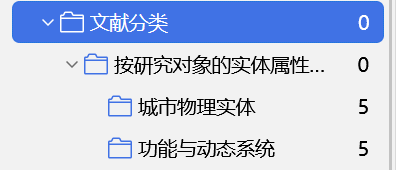

删除工作台里的分类结果、运行或体系，只会清除本地数据和关联记录，不会删除已经写入 Zotero 的条目、附件、标签或集合。

原始 PDF、提取文本和 SQLite 数据库默认保存在本机 `data/`。调用 Jev 时会发送标题、摘要、关键词和类别定义，摘要缺失时补充正文节选；生成候选体系时会发送分类目的、类别要求和所选文献的统计语料概况。模型功能需要联网访问配置的服务。本地 Zotero 数据通过 `127.0.0.1:23119` Local API 访问，不会转发给模型服务，临时写入授权只保留在当前请求的内存中。
